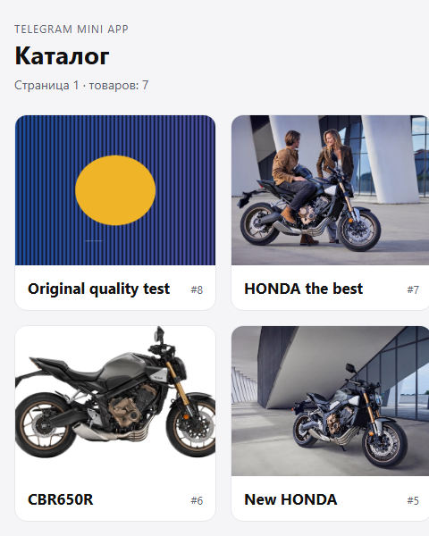

# telegram-catalog

Микросервис каталога товаров с Telegram Mini App.
Стек: Next.js (App Router) + TypeScript, FastAPI + SQLAlchemy 2 + Alembic,
aiogram 3, PostgreSQL 16, MinIO, Docker/Podman Compose.

## Возможности

- Бот по `/start` отвечает «У меня есть товар» и кнопкой «Каталог» (Telegram Mini App).
- Админ отправляет боту фото с подписью одним сообщением: изображение сохраняется в MinIO,
  запись о товаре — в PostgreSQL.
- Вместо фото можно отправить изображение файлом (JPEG/PNG/WebP до 5 МиБ) — так сохраняется
  оригинал без сжатия Telegram; обычные фото Telegram ужимает до ~1280 px.
  Лимит настраивается через `MAX_IMAGE_BYTES`.
- Страница «Каталог» работает в браузере и внутри Telegram Mini App, поддерживает тему Telegram.
- Все компоненты stateless: webhook, без локального состояния; API и бот масштабируются репликами.

## Скриншоты

Каталог (мобильная ширина, локальный web без туннеля):



## Архитектура

```
Telegram ──webhook──┐
                    ▼
Browser/TMA ───► web:3000 ──/telegram/*──► bot:8080 ──HTTP──┐
                    │                                       │
                    └──/api/*──► api:8000 ──SQL──► PostgreSQL 16
                                     └──────S3──► MinIO
```

- Публичный origin один: web проксирует `/api/*` в API и `/telegram/*` в бота.
- Картинки отдаёт API через `GET /api/products/{id}/image` (объект читается из MinIO).
- API не публикуется наружу; доступен только внутри compose-сети.
- `migrate` — one-shot сервис с `alembic upgrade head`; `minio-init` создаёт bucket,
  приложение-пользователя MinIO и policy.

## Быстрый старт

Требуется Docker Compose v2.20+ или Podman 4+ с compose-провайдером.

```bash
cp .env.example .env
# заполните секреты: POSTGRES_PASSWORD, MINIO_*, BOT_TOKEN, ADMIN_IDS,
# TELEGRAM_WEBHOOK_SECRET, API_INTERNAL_TOKEN
```

Секреты можно сгенерировать: `openssl rand -hex 32`
(в PowerShell: `[guid]::NewGuid().ToString('N')`).
Пароль PostgreSQL должен быть URL-safe (hex): compose подставляет его в URL как есть.
Для полного стека обязательны также `BOT_TOKEN`, `ADMIN_IDS`, `WEBAPP_URL`,
`TELEGRAM_WEBHOOK_URL`, `TELEGRAM_WEBHOOK_SECRET`; без них бот не стартует.

### Каталог без Telegram webhook

```bash
podman compose up --build -d db minio-perms minio minio-init migrate api web
```

- Каталог: http://localhost:3000
- PostgreSQL (только localhost): `localhost:5433`
- MinIO и API не публикуют host-порты; доступ к ним — только через compose-сеть и web.
  Для запуска API на хосте нужен отдельный override с портом MinIO и
  `MINIO_ENDPOINT=localhost:9000` (в репозиторий такой override не входит).
- API доступен через web: http://localhost:3000/api/products

### Полный стек с ботом (webhook)

Для webhook и Mini App нужен публичный HTTPS. Проще всего — quick tunnel Cloudflare:

```bash
# web уже запущен
cloudflared tunnel --url http://localhost:3000
```

Полученный `https://<random>.trycloudflare.com` пропишите в `.env`:

```dotenv
WEBAPP_URL=https://<random>.trycloudflare.com/
TELEGRAM_WEBHOOK_URL=https://<random>.trycloudflare.com/telegram/webhook
CORS_ORIGINS=["https://<random>.trycloudflare.com"]
```

Затем поднимите бота (он сам вызовет `setWebhook`):

```bash
podman compose up -d bot
```

Один туннель достаточен: web проксирует `/telegram/webhook` в бота.
Quick tunnel меняет URL после перезапуска — обновите `.env` и перезапустите бота.
Если quick tunnel нестабилен в вашей сети, используйте SSH-туннель
(`ssh -R 80:127.0.0.1:3000 nokey@localhost.run` или `serveo.net`); бесплатные
туннели живут ограниченное время, после смены URL обновите `.env` и webhook.

### Локальный polling (без HTTPS)

Только для отладки, один инстанс бота:

```dotenv
BOT_MODE=polling
ALLOW_POLLING=true
TELEGRAM_WEBHOOK_URL=
```

```bash
podman compose up -d bot
```

## Переменные окружения

| Переменная | Назначение |
|---|---|
| `POSTGRES_DB`, `POSTGRES_USER`, `POSTGRES_PASSWORD` | PostgreSQL; с хоста порт 5433 |
| `DATABASE_URL` | для локального запуска API вне compose |
| `MINIO_ROOT_USER`, `MINIO_ROOT_PASSWORD` | root-доступ MinIO (только инициализация) |
| `MINIO_APP_USER`, `MINIO_APP_PASSWORD` | пользователь приложения, доступ только к bucket |
| `MINIO_ENDPOINT`, `MINIO_BUCKET`, `MINIO_SECURE` | S3-подключение API |
| `BOT_TOKEN` | токен от @BotFather |
| `TELEGRAM_API_IP` | IPv4 api.telegram.org, если DNS/адрес блокируется (default 149.154.167.220) |
| `ADMIN_IDS` | Telegram user id админов через запятую |
| `WEBAPP_URL` | публичный HTTPS-адрес каталога (кнопка Mini App) |
| `BOT_MODE` | `webhook` (по умолчанию) или `polling` |
| `ALLOW_POLLING` | `true` разрешает polling; только локально |
| `TELEGRAM_WEBHOOK_URL` | `https://<host>/telegram/webhook` |
| `TELEGRAM_WEBHOOK_SECRET` | секрет заголовка `X-Telegram-Bot-Api-Secret-Token` |
| `API_INTERNAL_TOKEN` | общий токен bot → api (`X-Internal-Token`) |
| `API_INTERNAL_URL` | build-time rewrites web + runtime SSR-фетч |
| `BOT_INTERNAL_URL` | только build-time rewrites web для `/telegram/*` |
| `CORS_ORIGINS` | JSON-массив origin, если API вызывается напрямую |
| `MAX_IMAGE_BYTES` | максимальный размер изображения, по умолчанию 5 МиБ |
| `DB_POOL_SIZE`, `DB_MAX_OVERFLOW` | пул соединений БД на реплику API (5/10) |

`API_INTERNAL_URL` и `BOT_INTERNAL_URL` участвуют в `next build` (rewrites), поэтому
в Dockerfile и compose они задаются одинаково на build и runtime. Runtime-значение
`API_INTERNAL_URL` дополнительно использует SSR-фетч. После изменения этих адресов
обязательна пересборка web (`--build`), иначе rewrites останутся старыми.

## API

- `GET /health` — проверка API и БД.
- `GET /ready` — проверка БД и доступности bucket MinIO (используется healthcheck'ом).
- `GET /api/products?limit=100&offset=0` — список товаров (`limit` 1..100).
- `POST /api/products` — multipart `title` + `image`, заголовок `X-Internal-Token`,
  опционально `X-Idempotency-Key` (повторный запрос возвращает тот же товар).
- `GET /api/products/{id}/image` — изображение из MinIO.

Валидация: размер, MIME и magic bytes (JPEG/PNG/WebP), заголовок 1..200 символов.
Коды: 201/400/401/404/413/415/422/500/503.

## Тесты и проверки

```bash
# API и бот в контейнерах (тестовая БД создаётся initdb: <POSTGRES_DB>_test)
podman compose --profile test run --build --rm api-tests
podman compose --profile test run --build --rm bot-tests
podman compose --profile test run --build --rm api-tests ruff check .
podman compose --profile test run --build --rm bot-tests ruff check .

# web
cd web
npm ci
npm run typecheck
npm run lint
npm run build
```

Тесты API используют `TEST_DATABASE_URL` и требуют имя БД с суффиксом `_test`.
Локальный запуск тестов возможен с тестовым контейнером на `localhost:5433`;
не запускайте его одновременно с compose-БД (порт занят).
`TEST_DATABASE_URL` задаётся вручную (compose собирает URL из `POSTGRES_*` и не читает
эту переменную из `.env`).

Проверка миграций:

```bash
podman compose run --build --rm migrate
```

БД `${POSTGRES_DB}_migrate` создаётся initdb для отдельной проверки `alembic check`.
initdb выполняется только на пустом volume: если тестовой БД нет на старом volume,
пересоздайте его (`podman compose down -v`) или создайте БД вручную.

## Stateless и масштабирование

```bash
podman compose up -d --scale api=2 --scale bot=2
```

- API и бот не хранят состояние в процессе: данные в PostgreSQL, файлы в MinIO.
- Web проксирует `/api/*` на DNS-имя `api`, `/telegram/*` — на `bot`.
  DNS возвращает адреса реплик, но клиент обычно переиспользует соединение:
  это даёт ёмкость и частичный failover, а не гарантированный round-robin.
  Для строгого балансирования нужен внешний reverse-proxy.
- Web опубликован на фиксированном порту 3000; для нескольких реплик web нужен
  внешний балансировщик.
- Пул БД по умолчанию 5+10 соединений на реплику; при большом числе реплик
  учитывайте `max_connections` PostgreSQL или используйте PgBouncer.

## Диагностика

- **`api.telegram.org` недоступен / `Network is unreachable`.** В некоторых сетях
  блокируется DNS-адрес Telegram. Укажите рабочий IPv4 в `TELEGRAM_API_IP`
  (по умолчанию `149.154.167.220`) — compose добавит его в `/etc/hosts` бота.
  Проверка: `curl --resolve api.telegram.org:443:149.154.167.220
  https://api.telegram.org/bot<TOKEN>/getMe`.
- **Quick tunnel обрывается.** Cloudflare quick tunnel может переподключаться;
  как альтернативу используйте `ssh -R 80:127.0.0.1:3000 nokey@localhost.run`
  (URL печатается в stdout). Для стабильного адреса нужен named tunnel/домен.
  После смены URL обновите `.env` и перезапустите бота: `podman compose up -d bot`.
- **`TelegramBadRequest` при `/start`.** Если админ ещё не открывал чат с ботом,
  Telegram отвечает `chat not found`. Нажмите Start в боте от имени админа.
- **`/health` 200, но картинки не работают.** Проверьте `/ready` и policy MinIO;
  `minio-init` пересоздаёт policy при каждом запуске.

## Замечания по образу MinIO

Официальные образы `minio/minio` и `minio/mc` в Docker Hub/Quay недоступны для
анонимного pull. В compose используются публичные зеркала с фиксированными тегами:
`alpine/minio` (сервер) и `rancher/mirrored-minio-mc` (клиент инициализации).
Для продакшена замените их на образы из вашего registry.

## Структура

```
api/       FastAPI, SQLAlchemy, Alembic, тесты
bot/       aiogram 3, webhook-сервер, клиент API, тесты
web/       Next.js App Router, Telegram Mini App
deploy/    initdb-скрипты инфраструктуры
compose.yaml
```
